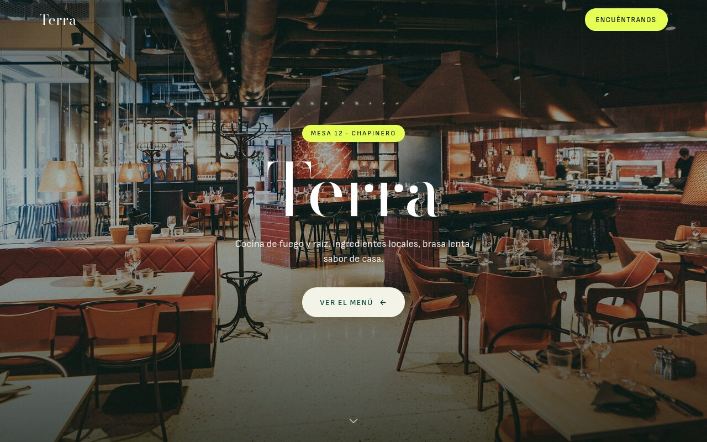
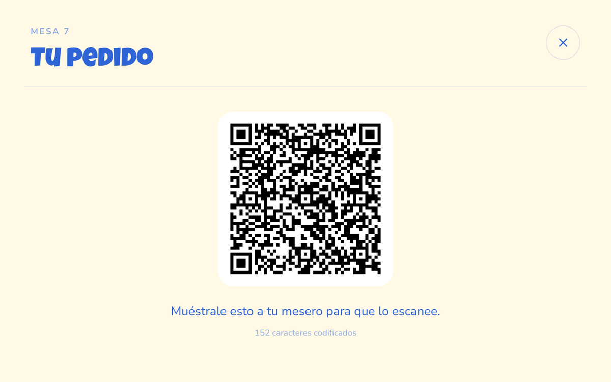
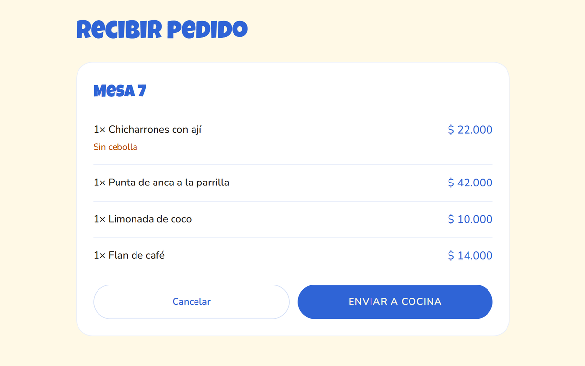
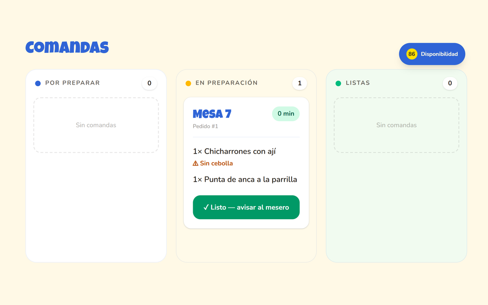
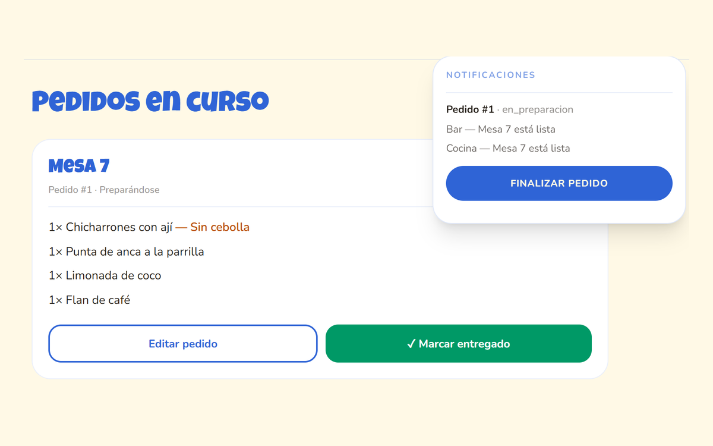
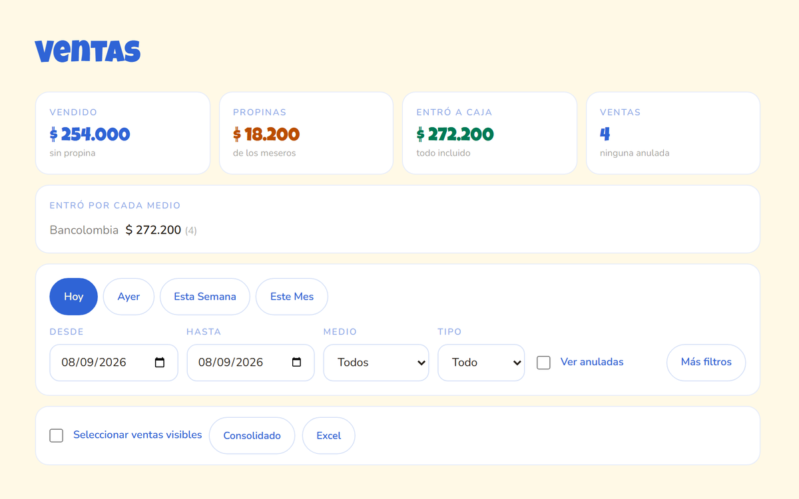
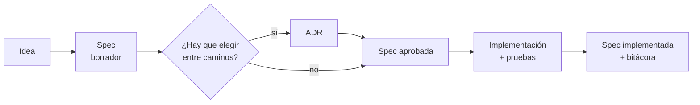
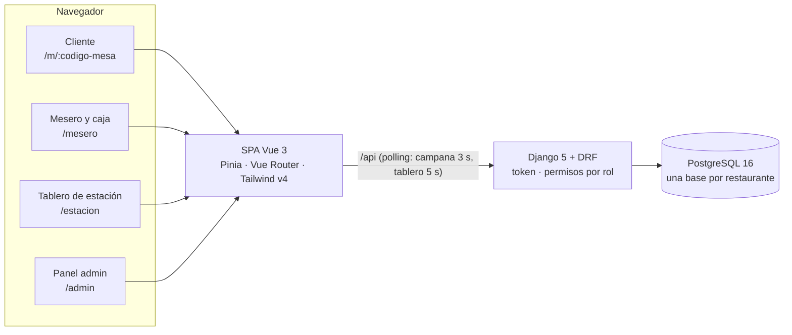
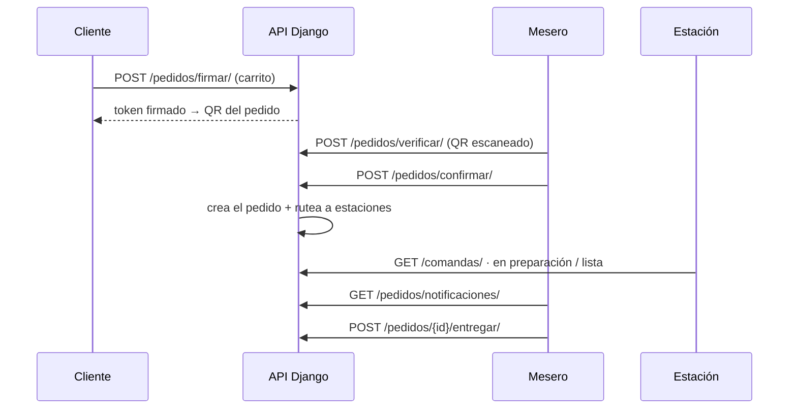

<p align="center"></p>

<p align="center"><a href="README.md">English</a> · <b>Español</b></p>

<p align="center">
  <b>Sistema POS para restaurantes en el que un código QR lleva el pedido del celular del cliente al mesero, a la cocina y a la caja.</b>
</p>

<p align="center">
  
  
  
  
  
  
  
  <br>
  
  
  
</p>

<p align="center">
  
  <br>
  <sub>Página del cliente del restaurante de demostración (prototipo visual de la Fase 0; la app en Vue porta este diseño y lee cada texto, color e imagen desde la configuración).</sub>
</p>

---

## Cómo viaja un pedido

El cliente escanea el QR de la mesa, arma su pedido en el celular y obtiene un **QR firmado del pedido**. El mesero lo escanea, lo revisa y lo envía; el sistema **lo parte por estaciones**, la cocina lo marca listo y el mesero recibe el aviso.

<table>
  <tr>
    <td width="50%"><br><b>1 · QR del pedido.</b> El servidor firma el carrito y se muestra como QR, sin guardar una fila por cada QR.</td>
    <td width="50%"><br><b>2 · El mesero confirma.</b> Lo escanea con la cámara o desde una imagen y lo envía a cocina.</td>
  </tr>
  <tr>
    <td width="50%"><br><b>3 · Tablero de estación.</b> Cada estación recibe solo lo suyo, con observaciones como "sin cebolla".</td>
    <td width="50%"><br><b>4 · Listo → entregado.</b> La campana del mesero dice qué estación terminó y de qué mesa.</td>
  </tr>
</table>

<sub>Pantallas de la app en Vue, con un tema de demostración alterno. Cambiar de marca es un cambio de configuración, no de código.</sub>

## Funcionalidades

- **QR del pedido firmado.** El pedido viaja dentro del QR, firmado con `django.core.signing` y con vigencia configurable (6 h por defecto), así los QR que nunca se usan no tocan la base de datos ([ADR-001](Documentacion/03-Decisiones/ADR-001%20-%20QR%20autocontenido%20y%20firmado.md)).
- **El mesero confirma.** Un pedido llega a cocina solo cuando un mesero con sesión lo confirma, así toda venta tiene responsable ([ADR-002](Documentacion/03-Decisiones/ADR-002%20-%20El%20mesero%20confirma%20el%20pedido.md)). Hay tres formas de tomarlo: escaneo con cámara, subir la imagen del QR o armar el pedido desde cero.
- **Funciona en iPhone.** El escaneo usa `qr-scanner` en vez del `BarcodeDetector` nativo, que Safari en iOS no implementa ([ADR-005](Documentacion/03-Decisiones/ADR-005%20-%20Escaneo%20con%20libreria%20JS.md)).
- **Ruteo automático a estaciones.** Un pedido confirmado se divide en una comanda por estación (cocina, bar, postres…) según la estación de cada categoría. El ruteo es idempotente, y un interruptor puede mandar todo a una sola cocina.
- **Tablero de cocina.** Por preparar → En preparación → Listas, con un cronómetro que pasa a ámbar a los 10 min y a rojo a los 20, y la opción de agotar platos desde la misma cocina.
- **Novedades sobre pedidos enviados.** El mesero puede agregar o quitar platos y cambiar cantidades, observaciones, mesa o domicilio. Cada cambio queda como un evento y nunca sobrescribe el pedido ([ADR-007](Documentacion/03-Decisiones/ADR-007%20-%20Una%20novedad%20es%20un%20evento%2C%20no%20una%20modificacion.md)).
- **Salón y domicilios.** Estado de las mesas en vivo (libre, apartada, ocupada) y pedidos a domicilio sin mesa.
- **Cuentas y turnos de caja.** Varios medios de pago, propinas, costo de envío, cálculo de vueltos, cajas de fondos, traslados y un cierre de turno que detecta faltantes y sobrantes. Toda decisión sobre dinero bloquea la fila primero, así un doble toque nunca cobra dos veces ([ADR-008](Documentacion/03-Decisiones/ADR-008%20-%20Bloquear%20la%20fila%20antes%20de%20decidir%20sobre%20dinero.md)).
- **Ventas, tiquetes y reportes.** Historial de ventas con búsqueda, tiquetes de venta imprimibles, exportación a Excel hecha solo con la biblioteca estándar y cinco reportes con Chart.js.
- **Promociones y clientes.** Los combos con vigencia se modelan como un tipo especial de plato ([ADR-009](Documentacion/03-Decisiones/ADR-009%20-%20La%20promocion%20es%20un%20tipo%20de%20plato.md)). Los clientes de domicilio se reconocen y se guardan solos.
- **100 % parametrizable.** Nombre, paleta, tipografías, imágenes, menú, estaciones, mesas, medios de pago y usuarios se administran desde el panel. El tema se aplica en tiempo de ejecución con variables CSS, sin recompilar.
- **Acceso por rol.** Roles de mesero, cajero, cocina y administrador, autenticación por token de DRF y guardas de ruta en Vue Router.
- **Pensado para la contabilidad.** Cada línea del pedido congela el nombre y el precio del plato al momento de la venta, y los pedidos se anulan con motivo y responsable, nunca se borran.

<p align="center">
  
  <br>
  <sub>Historial de ventas: totales, propinas, entradas a caja por medio de pago, filtros, consolidado y exportación a Excel.</sub>
</p>

## Proceso de ingeniería

El proyecto se construye con **Spec Driven Development**: la especificación es la fuente de verdad y el código es su implementación. Todo el contexto vive en una bóveda de Obsidian en [`Documentacion/`](Documentacion/).

| | |
|---|---|
| **25 specs** | Propósito, alcance, fuera de alcance, comportamiento y criterios de aceptación verificables. 22 implementadas, 2 en borrador y 1 aprobada que espera un servidor real. El código las referencia (`# SPEC-005`). |
| **9 ADR** | Decisiones de arquitectura con las opciones descartadas: QR firmado, confirmación del mesero, una base por restaurante, LISTO ≠ ENTREGADO, escaneo con librería JS, stack, eventos en vez de ediciones, bloqueo de fila, promociones como platos. |
| **Bitácora** | 38 entradas que registran qué se construyó, qué defectos aparecieron y por qué. |
| **Prueba de estrés** | 3 meseros, 2 cocineros y 50 clientes durante 11 minutos: 2.799 peticiones con **0 errores del servidor** y p95 ≤ 285 ms en el servidor de desarrollo. Dos cocineros que tomaron la misma comanda recibieron un `409`, un doble toque en *Cobrar* produjo un solo cobro, y los descuadres puestos a propósito se detectaron al peso. Apareció un defecto y se corrigió el mismo día. |



## Arquitectura

Django expone **solo una API** y los permisos, y nunca renderiza HTML de negocio. Toda la interfaz (cliente, mesero, estación, caja y administración) es una SPA en Vue. En desarrollo, Vite reenvía `/api` y `/media` a Django, así la app funciona igual desde un celular en la red local y sin CORS.





## Stack tecnológico

| Capa | Herramientas |
|---|---|
| **Backend** | Python 3.11, Django 5.0, Django REST Framework, django-filter, django-cors-headers, Pillow, python-dotenv |
| **Frontend** | Vue 3.5 (`<script setup>`), Vite 8, Vue Router, Pinia, Tailwind CSS v4, Axios, Chart.js |
| **QR** | `qrcode` (generar), `qr-scanner` (cámara, Web Worker), `jsQR` (desde imagen), `django.core.signing` (firmar y verificar) |
| **Datos** | PostgreSQL 16 con Docker Compose (solo la base; Django y Vite corren nativos) |

## Cómo empezar

**Requisitos:** Python 3.11+, Node.js 20+ (desarrollado con 24), Docker.

```bash
# 1. Entorno y base de datos
cp .env.example .env              # y ajusta tus propios valores locales
docker compose up -d db           # PostgreSQL 16 en el puerto 5433

# 2. Backend
cd backend
python -m venv .venv
source .venv/bin/activate         # Windows: .venv\Scripts\activate
pip install -r requirements.txt
python manage.py migrate
python manage.py createsuperuser

# datos de demostración: tema, menú, estaciones, mesas, medios de pago, usuarios por rol
python manage.py cargar_configuracion_demo
python manage.py cargar_menu_demo
python manage.py cargar_estaciones_demo
python manage.py cargar_mesas_demo
python manage.py cargar_medios_pago_demo
python manage.py crear_usuarios_demo

python manage.py runserver        # http://127.0.0.1:8000

# 3. Frontend (otra terminal)
cd frontend
npm install
npm run dev                       # http://localhost:5173
```

Luego abre:

| Pantalla | URL |
|---|---|
| Cliente (mesa 12) | `http://localhost:5173/m/x7f2q9` |
| Mesero | `http://localhost:5173/mesero` |
| Tablero de estación | `http://localhost:5173/estacion` |
| Panel de administración | `http://localhost:5173/admin` |

Otros comandos útiles:

```bash
python manage.py test                     # pruebas del backend
python manage.py poblar_demo              # llena todas las pantallas con datos de ejemplo
python manage.py limpiar_pedidos --si     # borra los pedidos, conserva menú y configuración
cd prototipo && python -m http.server 8791   # prototipo estático de la Fase 0
```

> [!NOTE]
> [`GUION-DEMO.md`](GUION-DEMO.md) recorre paso a paso una demostración completa.

## Estructura del proyecto

```text
Menu-flow/
├── backend/                 proyecto Django (solo API)
│   ├── nucleo/              settings, router de la API, roles y permisos, usuarios
│   ├── configuracion/       parámetros de negocio y tema en tiempo de ejecución
│   ├── menu/                categorías, platos, etiquetas, promociones
│   ├── pedidos/             mesas, pedidos, QR firmado, novedades
│   ├── estaciones/          estaciones, comandas, ruteo
│   ├── ventas/              cuentas, turnos, cajas, reportes, tiquetes
│   └── clientes/            clientes de domicilio
├── frontend/                SPA Vue 3 + Vite + Tailwind v4
│   └── src/views/           ClienteMenu · mesero/ · estacion/ · admin/
├── Documentacion/           bóveda Obsidian: producto, SPEC, ADR, diseño, investigación, bitácora
├── prototipo/               prototipo visual estático de la Fase 0
├── pruebas/prueba-qr/       prueba de viabilidad del QR
├── Entregables/             trabajos académicos construidos sobre el proyecto
└── docker-compose.yml       PostgreSQL local
```

## Estado y hoja de ruta

**La Fase 1 está cerrada:** el flujo completo del restaurante funciona de punta a punta en local. Todavía no está desplegado. Lo que sigue, según la bóveda:

- [ ] Contabilidad y auditoría (SPEC-008) y PQRSF (SPEC-010), ambas en borrador
- [ ] Actualizaciones en tiempo real con WebSockets (Django Channels) en vez de polling
- [ ] Paso a producción: servidor, HTTPS, ajustes de seguridad, respaldos y una base limpia
- [ ] Despliegue de una instancia por restaurante probado en un servidor real (SPEC-009)

## Autor

**Walter Velasco**: estudiante de ingeniería de software, Colombia.
[github.com/waldooCreator](https://github.com/waldooCreator)
