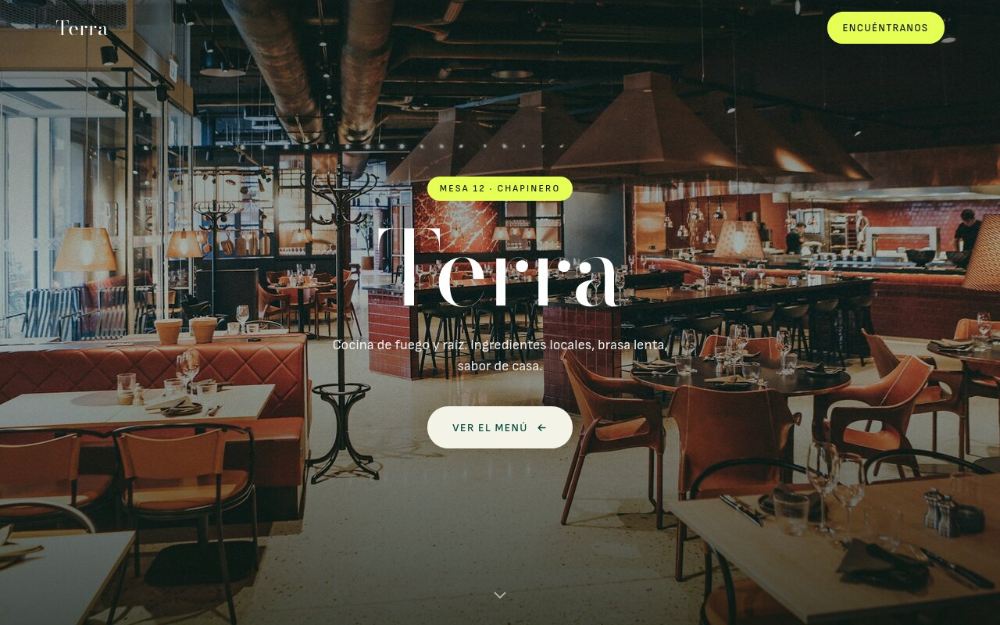
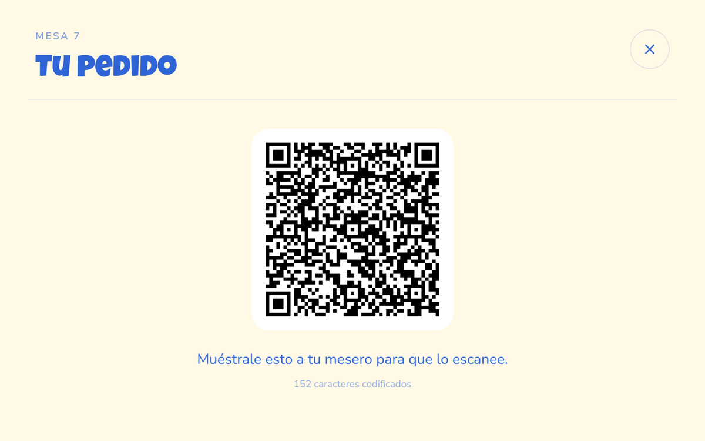
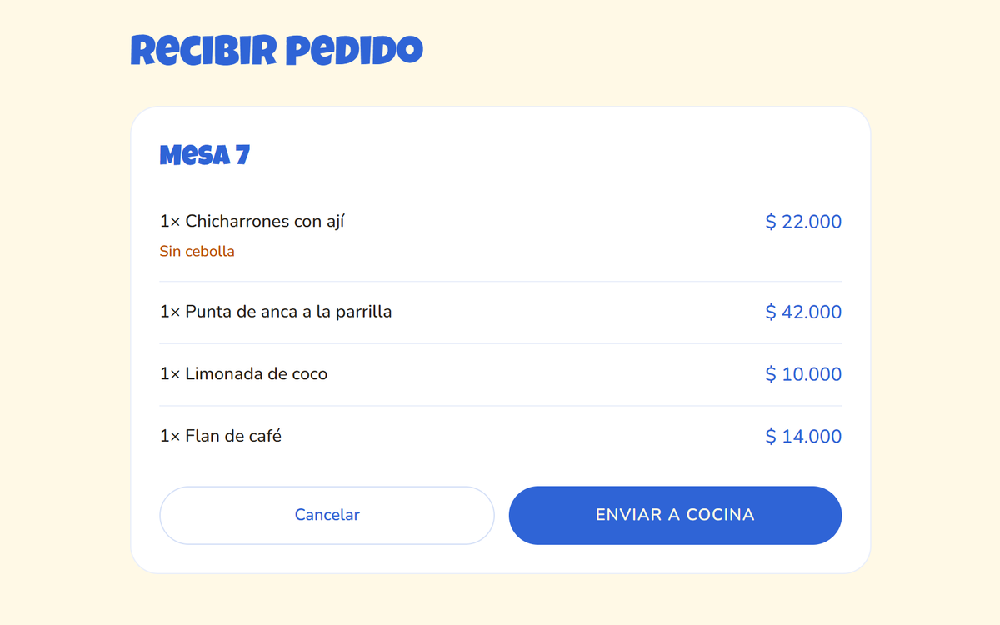
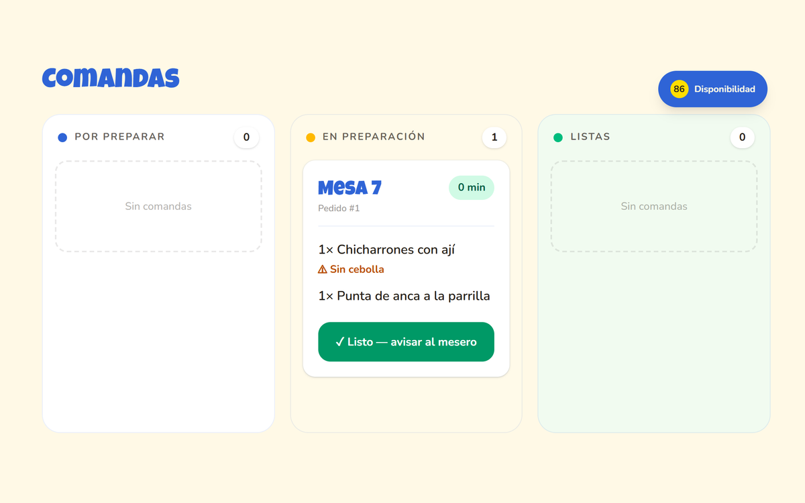
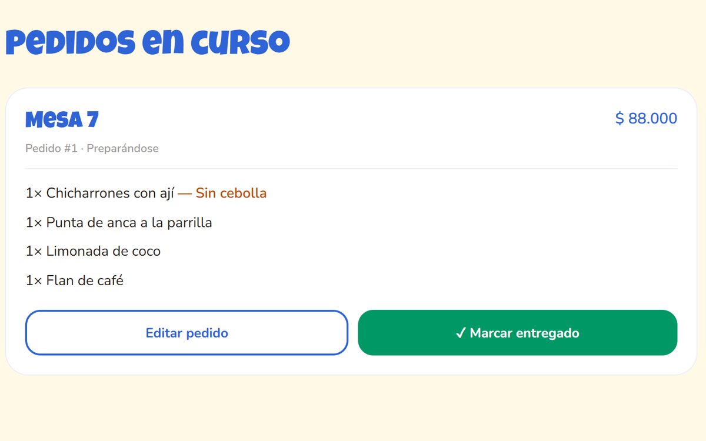
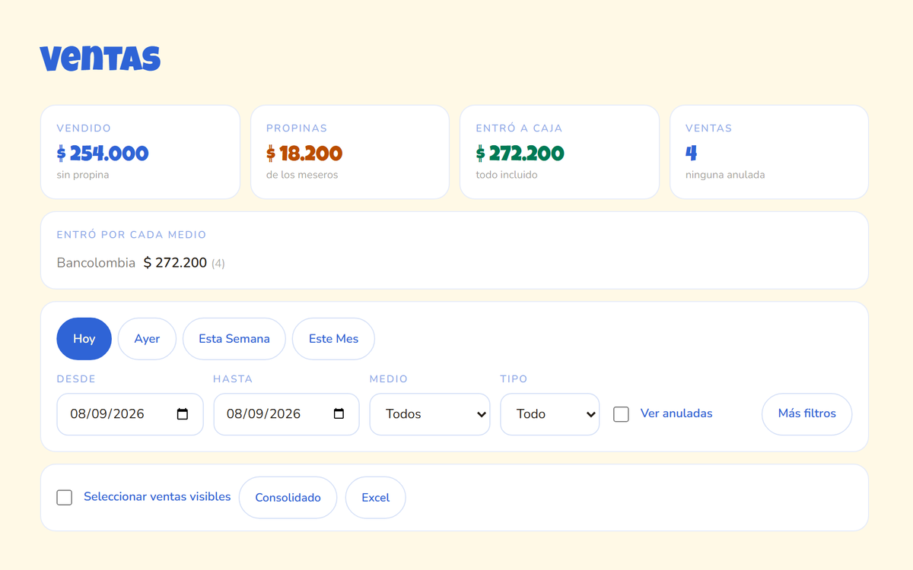
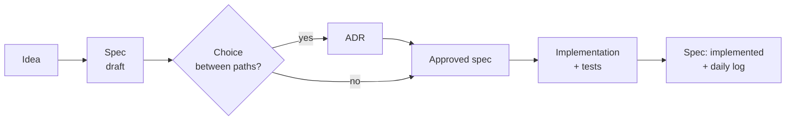
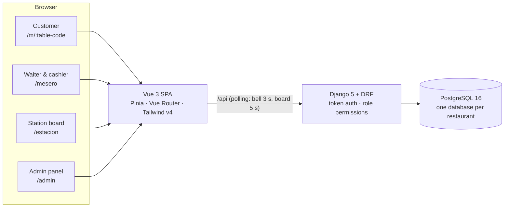
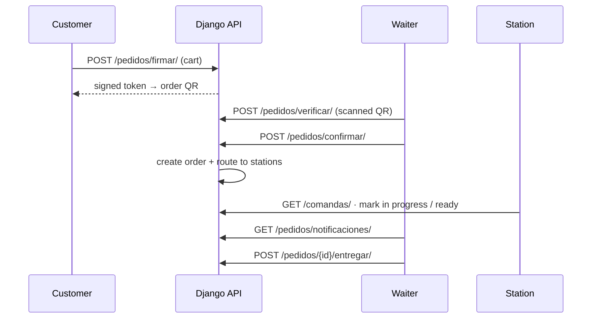

<p align="center"></p>

<p align="center"><b>English</b> · <a href="README.es.md">Español</a></p>

<p align="center">
  <b>A restaurant point-of-sale system where a QR code carries the order from the customer's phone to the waiter, the kitchen and the cash register.</b>
</p>

<p align="center">
  
  
  
  
  
  
  
</p>

<p align="center">
  
  <br>
  <sub><b>Brand A:</b> customer page of a demo restaurant, from the Phase 0 visual prototype. The Vue app ports this design and reads every text, color and image from configuration.</sub>
</p>

---

## How an order flows

The customer scans the QR on the table, builds an order on their phone and gets a **signed QR of the order**. The waiter scans it, reviews it and sends it; the system **splits it by station**, the kitchen marks it ready, and the waiter is notified.

<table>
  <tr>
    <td width="50%"><br><b>1 · Order QR.</b> The cart is signed by the server and shown as a QR, with no database row per QR.</td>
    <td width="50%"><br><b>2 · Waiter confirms.</b> Scanned with the camera or from an image, then sent to the kitchen.</td>
  </tr>
  <tr>
    <td width="50%"><br><b>3 · Station board.</b> Each station only receives its own items, with notes like "no onion".</td>
    <td width="50%"><br><b>4 · Ready → delivered.</b> The waiter's bell says which station finished, and the waiter closes the loop with <i>Mark delivered</i>.</td>
  </tr>
</table>

<p align="center"><b>One codebase, any brand.</b> The hero above is <b>Brand A</b>; these screens run the Vue app with <b>Brand B</b>, a second demo theme. Name, palette, fonts and images come from configuration, so switching brands needs no code change and no rebuild.</p>

## Features

- **Signed order QR.** The order travels inside the QR, signed with `django.core.signing` and valid for a configurable time (6 h by default), so unused QRs never touch the database ([ADR-001](Documentacion/03-Decisiones/ADR-001%20-%20QR%20autocontenido%20y%20firmado.md)).
- **Waiter in the loop.** Orders reach the kitchen only after a logged-in waiter confirms them, so every sale has an owner ([ADR-002](Documentacion/03-Decisiones/ADR-002%20-%20El%20mesero%20confirma%20el%20pedido.md)). Three ways in: live camera scan, QR image upload, or building the order from scratch.
- **Works on iPhone.** Camera scanning uses `qr-scanner` instead of the native `BarcodeDetector`, which Safari on iOS does not implement ([ADR-005](Documentacion/03-Decisiones/ADR-005%20-%20Escaneo%20con%20libreria%20JS.md)).
- **Automatic station routing.** A confirmed order is split into one ticket per station (kitchen, bar, desserts…) from each category's station. The routing is idempotent, and a single switch can send everything to one kitchen.
- **Kitchen board.** To prepare → In progress → Ready, with a timer that turns amber at 10 min and red at 20, and dishes can be marked sold out right from the kitchen.
- **Changes after sending.** Waiters can add or remove dishes, change quantities, notes, table or delivery. Every change is stored as an event and never overwrites the order ([ADR-007](Documentacion/03-Decisiones/ADR-007%20-%20Una%20novedad%20es%20un%20evento%2C%20no%20una%20modificacion.md)).
- **Floor and deliveries.** Live table status (free, reserved, occupied) and delivery orders with no table.
- **Bills and cash shifts.** Multiple payment methods, tips, delivery fee, cash change calculation, cash boxes, transfers and a shift close that detects cash over and short. Money decisions lock the row first, so a double tap never charges twice ([ADR-008](Documentacion/03-Decisiones/ADR-008%20-%20Bloquear%20la%20fila%20antes%20de%20decidir%20sobre%20dinero.md)).
- **Sales, tickets and reports.** Searchable sales history, printable sale tickets, Excel export built with the standard library only, and five Chart.js reports.
- **Promotions and customers.** Time-limited combos are modelled as a special kind of dish ([ADR-009](Documentacion/03-Decisiones/ADR-009%20-%20La%20promocion%20es%20un%20tipo%20de%20plato.md)). Delivery customers are recognised and saved automatically.
- **Fully configurable.** Name, palette, fonts, images, menu, stations, tables, payment methods and users are managed from the admin panel. The theme is applied at runtime through CSS variables, so no rebuild is needed.
- **Role-based access.** Waiter, cashier, kitchen and admin roles, DRF token authentication, and route guards in the Vue router.
- **Accounting-safe by design.** Each order line freezes the dish's name and price at sale time, and orders are voided with a reason and a responsible user, never deleted.

<p align="center">
  
  <br>
  <sub>Sales history: totals, tips, cash received per payment method, filters, consolidated view and Excel export.</sub>
</p>

## Engineering process

The project is built with **Spec Driven Development**: the spec is the source of truth and the code implements it. All the context lives in an Obsidian vault in [`Documentacion/`](Documentacion/).

| Artifact | What it holds |
|---|---|
| **25 specs** | Purpose, scope, out of scope, behaviour and verifiable acceptance criteria. 22 implemented, 2 drafts and 1 approved that is waiting for a real server. The code references them (`# SPEC-005`). |
| **9 ADRs** | Architecture decisions with the options that were rejected: signed QR, waiter confirmation, one database per restaurant, READY ≠ DELIVERED, JS QR scanning, stack, events over edits, row locking, promotions as dishes. |
| **228 backend tests** | Django test cases for orders, sales and cash, menu, customers and roles, run with `python manage.py test`. |
| **Daily log** | 38 entries recording what was built, which bugs showed up, and why. |
| **Stress test** | 3 waiters, 2 cooks and 50 customers over 11 minutes: 2,799 requests with **0 server errors**, p95 ≤ 285 ms on the dev server. Two cooks grabbing the same ticket got a `409`, a double tap on *Charge* produced a single charge, and deliberate cash shortages were detected to the peso. One defect was found and fixed the same day. |



## Architecture

Django exposes **only an API** and permissions and never renders business HTML. The whole UI (customer, waiter, station, cashier and admin) is a Vue SPA. In development, Vite proxies `/api` and `/media` to Django, so the app works the same from a phone on the local network with no CORS.





## Tech stack

| Layer | Tools |
|---|---|
| **Backend** | Python 3.11, Django 5.0, Django REST Framework, django-filter, django-cors-headers, Pillow, python-dotenv, psycopg 3 |
| **Frontend** | Vue 3.5 (`<script setup>`), Vite 8, Vue Router, Pinia, Tailwind CSS v4, Axios, Chart.js |
| **QR** | `qrcode` (generate), `qr-scanner` (camera, Web Worker), `jsQR` (from image), `django.core.signing` (sign and verify) |
| **Data** | PostgreSQL 16 via Docker Compose (database only; Django and Vite run natively) |

## Getting started

**Requirements:** Python 3.11 or 3.12, Node.js 20.19+ or 22.12+ (developed on 24), Docker.

```bash
# 1. Environment and database
cp .env.example .env              # then set your own local values
docker compose up -d db           # PostgreSQL 16 on port 5433

# 2. Backend
cd backend
python -m venv .venv
source .venv/bin/activate         # Windows: .venv\Scripts\activate
pip install -r requirements.txt
python manage.py migrate
python manage.py createsuperuser

# demo data: theme, menu, stations, tables, payment methods, role users
python manage.py cargar_configuracion_demo
python manage.py cargar_menu_demo
python manage.py cargar_estaciones_demo
python manage.py cargar_mesas_demo
python manage.py cargar_medios_pago_demo
python manage.py crear_usuarios_demo

python manage.py runserver        # http://127.0.0.1:8000

# 3. Frontend (new terminal)
cd frontend
npm install
npm run dev                       # http://localhost:5173
```

Then open:

| Screen | URL |
|---|---|
| Customer (table 12) | `http://localhost:5173/m/x7f2q9` |
| Waiter | `http://localhost:5173/mesero` |
| Station board | `http://localhost:5173/estacion` |
| Admin panel | `http://localhost:5173/admin` |

Other useful commands:

```bash
python manage.py test                     # backend test suite
python manage.py poblar_demo              # fill every screen with sample data
python manage.py limpiar_pedidos --si     # reset orders, keep menu and config
cd prototipo && python -m http.server 8791   # Phase 0 static prototype
```

> [!NOTE]
> [`GUION-DEMO.md`](GUION-DEMO.md) walks through a full live demo step by step (in Spanish).

## Project structure

```text
Menu-flow/
├── backend/                 Django project (API only)
│   ├── nucleo/              settings, API router, roles & permissions, users
│   ├── configuracion/       runtime business parameters and theme
│   ├── menu/                categories, dishes, tags, promotions
│   ├── pedidos/             tables, orders, signed QR, in-flight changes
│   ├── estaciones/          stations, kitchen tickets, routing
│   ├── ventas/              bills, cash shifts, cash boxes, reports, tickets
│   └── clientes/            delivery customers
├── frontend/                Vue 3 + Vite + Tailwind v4 SPA
│   └── src/views/           ClienteMenu · mesero/ · estacion/ · admin/
├── Documentacion/           Obsidian vault: product, SPECs, ADRs, design, research, log
├── prototipo/               Phase 0 static visual prototype
├── pruebas/prueba-qr/       QR payload feasibility test
├── Entregables/             academic deliverables built on this project
└── docker-compose.yml       local PostgreSQL
```

## Status and roadmap

**Phase 1 is complete:** the whole restaurant flow works end to end locally. The project is not deployed yet. Next, as listed in the vault:

- [ ] Accounting and audit (SPEC-008) and customer feedback / PQRSF (SPEC-010), both drafted
- [ ] Real-time updates over WebSockets (Django Channels) instead of polling
- [ ] Production rollout: server, HTTPS, hardened settings, backups and a clean database
- [ ] One-instance-per-restaurant deployment tested on a real server (SPEC-009)

## Author

**Walter Velasco**: software engineering student, Colombia.
[github.com/waldooCreator](https://github.com/waldooCreator)
